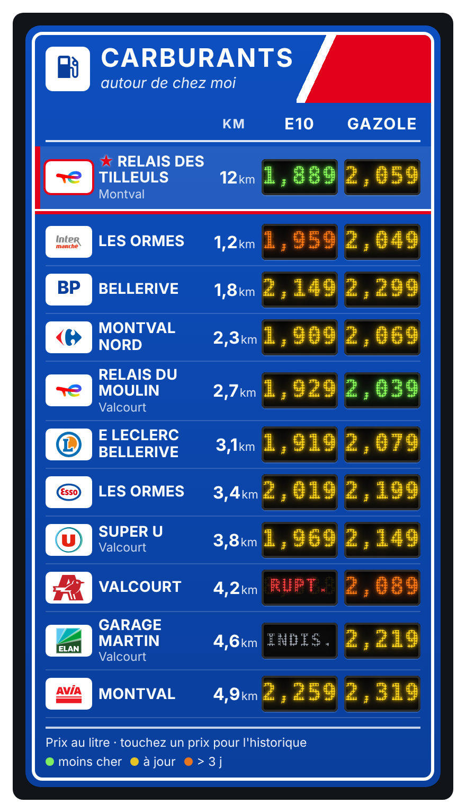
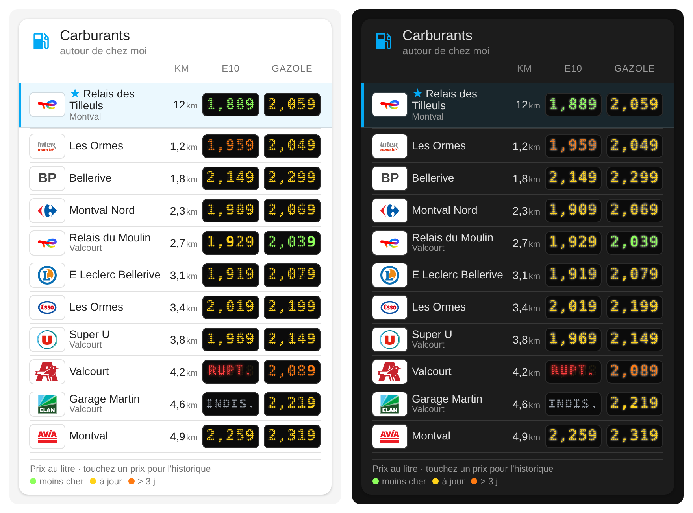
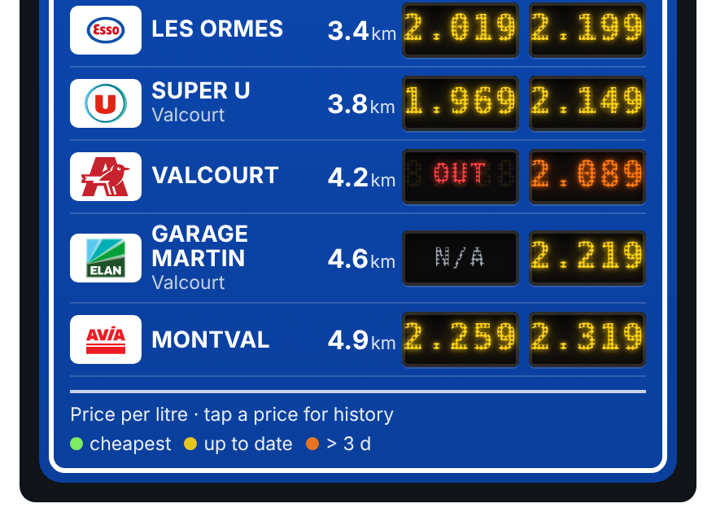
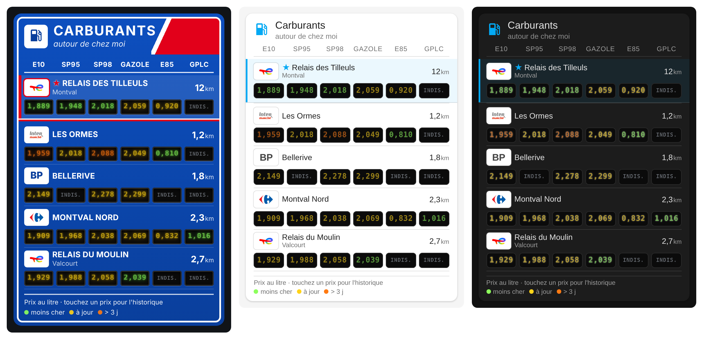

# Carburant LED Card ⛽

Carte Home Assistant façon **panneau d'autoroute** (ou en **style sobre** qui suit votre thème) qui affiche le prix des carburants des stations autour de chez vous : panneau bleu, **afficheurs LED à points**, logos des enseignes, distance, et vos stations favorites toujours en haut.





[](https://my.home-assistant.io/redirect/hacs_repository/?owner=Robote7701&repository=carburant-ledcard&category=plugin)

> 🇬🇧 [English version below](#-english)

---

## ✅ Ce qu'il faut avant

La carte n'interroge aucun site elle-même : elle affiche les données de l'intégration **[Prix Carburant](https://github.com/Aohzan/hass-prixcarburant)** (Aohzan/hass-prixcarburant), qui lit les données ouvertes de [prix-carburants.gouv.fr](https://www.prix-carburants.gouv.fr/).

1. **Installez l'intégration** via HACS (dépôt `Aohzan/hass-prixcarburant`), puis redémarrez Home Assistant.
2. *Paramètres → Appareils et services → Ajouter une intégration →* **Prix Carburant**.
3. Dans **Configurer** : choisissez le rayon autour de chez vous, les carburants, et ajoutez si besoin des stations précises par leur ID (*Ajouter une station*).

💡 L'ID d'une station se trouve sur [prix-carburants.gouv.fr](https://www.prix-carburants.gouv.fr/) ou dans l'attribut `station_id` des capteurs.

## 🔌 Sur quelles entités elle se base

L'intégration crée **un capteur par station et par carburant** (`sensor.station_…_gazole`, `sensor.station_…_e10`…). La carte les trouve **toute seule** : aucun capteur à lister, et une nouvelle station apparaît automatiquement.

| Attribut lu | Utilisation dans la carte |
|---|---|
| état | prix affiché sur l'afficheur LED |
| `station_id`, `fuel_type` | regroupement par station et par colonne |
| `name`, `brand`, `city` | nom et ville affichés |
| `distance` | km, et tri par distance |
| `entity_picture` | logo de l'enseigne (fourni par l'intégration, option *Ajouter les logos*) |
| `days_since_last_update` | prix en **orange** s'il est trop ancien |
| `shortage_since` | **RUPT.** en rouge si le carburant est en rupture |
| `updated_date` | date du prix au survol |

## 🖥️ Ce que montre la carte

| Couleur / texte | Signification |
|---|---|
| 🟢 vert | le prix le moins cher de la colonne (parmi les stations affichées et les prix à jour) |
| 🟡 jaune | prix à jour |
| 🟠 orange | prix pas mis à jour depuis plus de `stale_days` jours |
| `RUPT.` rouge | carburant en rupture |
| `INDIS.` gris | carburant pas vendu dans cette station |
| ★ + liseré rouge | station épinglée (`pinned`) |

Toucher un prix ouvre l'historique du capteur. Les textes de la carte passent en anglais si Home Assistant est en anglais.



### Tous les carburants
Avec plus de 3 carburants, les afficheurs passent automatiquement **sous le nom** de la station et se partagent toute la largeur : ça tient même sur un téléphone. Ici les 6 carburants, 5 stations max :



## 📦 Installation

### Avec HACS (recommandé)
Cliquez sur le bouton **Ouvrir dans HACS** ci-dessus, ou :
1. HACS → menu **⋮** → **Dépôts personnalisés**.
2. URL : `https://github.com/robote7701/carburant-ledcard`, catégorie **Dashboard** (ou *Lovelace*).
3. Cherchez **Carburant LED Card** → **Télécharger**.
4. Rechargez la page (Ctrl+Maj+R). Dans l'app : *Paramètres → Réinitialiser le cache du frontend*.

### À la main
1. Copiez `carburant-ledcard.js` dans `/config/www/`.
2. *Paramètres → Tableaux de bord → ⋮ → Ressources → Ajouter* : URL `/local/carburant-ledcard.js`, type **Module JavaScript**.
3. Rechargez la page.

## ⚙️ Configuration

### Avec l'éditeur visuel
*Modifier le tableau de bord → Ajouter une carte →* **Carburant LED Card**.

### En YAML

```yaml
type: custom:carburant-ledcard
title: Carburants
subtitle: autour de chez moi
fuels: [E10, Gazole]
pinned:
  - "12345678"        # station toujours en haut
sort: distance
stale_days: 3
style: autoroute     # ou sobre
```

| Option | Défaut | Description |
|---|---|---|
| `title` | `Carburants` | titre du panneau |
| `subtitle` | — | sous-titre en italique |
| `fuels` | `[E10, Gazole]` | colonnes, dans l'ordre : `E10`, `SP95`, `SP98`, `Gazole`, `E85`, `GPLc` |
| `pinned` | `[]` | ID des stations à garder en haut (dans cet ordre) |
| `sort` | `distance` | `distance` ou `price` (prix du 1er carburant) |
| `stale_days` | `3` | au-delà, le prix passe en orange et n'est plus compté comme « moins cher » |
| `max_stations` | `0` | nombre max. de stations affichées (0 = toutes) |
| `show_logos` | `true` | afficher les logos fournis par l'intégration |
| `style` | `autoroute` | `autoroute` (panneau bleu) ou `sobre` (suit les couleurs du thème, clair ou sombre) |
| `layout` | `auto` | `row` (tout sur une ligne), `stacked` (afficheurs sous le nom) ; `auto` = empilé au-delà de 3 carburants |

## ⚠️ Limites
- Les prix sont ceux déclarés par les stations sur le site officiel : certaines ne les mettent pas à jour tous les jours (d'où la couleur orange).
- Pas de logo pour certaines enseignes : leur nom s'affiche alors en texte.
- Le style LED utilise une police à chasse fixe du système ; le rendu varie un peu selon l'appareil.

## 👀 Voir aussi
Pour l'historique des prix, le coût d'un plein et la fiche détaillée d'une station, voir la **[Carte Prix Carburant](https://github.com/Marlboro62/prix-carburant-card)** de Marlboro62 : elle utilise la même intégration et complète bien ce panneau.

## 🙏 Crédits
- Données : [prix-carburants.gouv.fr](https://www.prix-carburants.gouv.fr/) (Licence Ouverte Etalab).
- Intégration : [Aohzan/hass-prixcarburant](https://github.com/Aohzan/hass-prixcarburant), qui fournit aussi les logos des enseignes.
- Carte : robote7701 — licence MIT.

---

## 🇬🇧 English

A Home Assistant card that shows fuel prices of nearby French petrol stations as a **motorway sign** with **dot-matrix LED displays**, brand logos, distance, and your favourite stations pinned on top.

### Requirements
The card reads the sensors of the **[Prix Carburant](https://github.com/Aohzan/hass-prixcarburant)** integration (France only, data from prix-carburants.gouv.fr). Install it through HACS, add it in *Settings → Devices & services*, then pick a radius, fuels and optional station IDs in its options.

### Entities used
One sensor per station and fuel. The card discovers them automatically from their `station_id` and `fuel_type` attributes; it also reads `name`, `brand`, `city`, `distance`, `entity_picture`, `days_since_last_update`, `shortage_since` and `updated_date`.

Colours: 🟢 cheapest up-to-date price among the stations shown · 🟡 up to date · 🟠 older than `stale_days` · red `OUT` = shortage · grey `N/A` = fuel not sold. Tap a price to open its history. Labels follow the Home Assistant language (French or English).

### Install
HACS → **⋮** → **Custom repositories** → `https://github.com/robote7701/carburant-ledcard`, category **Dashboard** → download **Carburant LED Card**, then reload the page. Manual: copy `carburant-ledcard.js` to `/config/www/` and add `/local/carburant-ledcard.js` as a *JavaScript module* resource.

### Config
```yaml
type: custom:carburant-ledcard
fuels: [E10, Gazole]
pinned: ["12345678"]
sort: distance        # or price
stale_days: 3
max_stations: 0       # 0 = all
show_logos: true
style: autoroute      # or sobre (follows your theme)
layout: auto          # row | stacked (auto = stacked above 3 fuels)
```
A visual editor is available. MIT licence.

See also: [Prix Carburant Card](https://github.com/Marlboro62/prix-carburant-card) by Marlboro62, for price history, cost of a full tank and a detailed single-station view.
